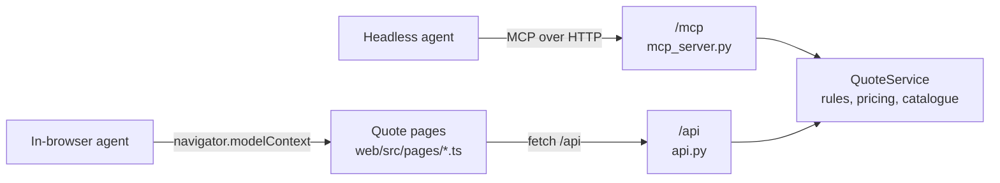

<div align="center">

# Voyara Travel Insurance

**One Quote API, two agent channels: an MCP server for headless agents and WebMCP tools for the agent in your browser tab.**

[](LICENSE)
[](server/pyproject.toml)
[](web/package.json)
[](#mcp-server)
[](#webmcp-in-chrome)

[Quick start](#quick-start) • [How it works](#how-it-works) • [How MCP works](how-to-mcp-works.md) • [How WebMCP works](how-to-webmcp-works.md) • [MCP server](#mcp-server) • [WebMCP](#webmcp-in-chrome) • [Tests](#tests) • [Contributing](CONTRIBUTING.md)

</div>

---

Voyara is a reference build showing how an insurer can let AI agents quote a policy without
letting them buy one. A chat assistant talks to the MCP server. A browser agent drives the
customer's own quote form through WebMCP. Both reach the same pricing and eligibility rules,
so a family skiing in Japan gets the same premium whichever agent asks.

> [!NOTE]
> Voyara is a fictitious Australian travel insurer. Every price, limit and policy wording in this
> repo is made up. Do not use it to make real insurance decisions.

## Quick start

Requires [`uv`](https://docs.astral.sh/uv/) and Node 22.22+ or 24.15+.

```sh
# Terminal 1: Quote API and MCP server on http://127.0.0.1:8000
cd server && uv run voyara-server
```

```sh
# Terminal 2: quote pages on http://localhost:5173/quote/ (proxies /api to the server)
cd web && npm install && npm run dev
```

To see how the two channels work, open the walkthrough at `http://localhost:5173/flow`. It steps
through every MCP and WebMCP message with real requests and animates where each one goes.

Then connect Claude Code to the MCP server and ask for a quote:

```sh
claude mcp add --transport http voyara http://localhost:8000/mcp
```

> I'm going to Nepal for three weeks in April to trek to Everest Base Camp. I'm 27. What travel
> insurance do I need?

The agent gathers trip details, checks eligibility, recommends a tier with the Adventure Pack and
returns a quote with its disclosure. It hands you a checkout link. It cannot pay.

## How it works



| Channel | Who uses it | Entry point |
| --- | --- | --- |
| MCP (Streamable HTTP) | Chat assistants, scheduled tasks, any headless agent | `http://localhost:8000/mcp` |
| WebMCP | An agent working inside the customer's browser tab | `/quote/` and `/quote/results/` pages |
| Plain web | A person with no agent | The same pages, as a normal form |

Pricing and eligibility live only in `QuoteService`. The MCP tools and REST routes are thin
adapters over it, which is what keeps the two channels in step.

### Learn more

New to MCP or WebMCP, or curious how this example system fits together? Two guides walk through
each channel component by component, with a worked customer journey:

| Guide                                      | Explains                                                                                                                                                                          |
| ------------------------------------------ | --------------------------------------------------------------------------------------------------------------------------------------------------------------------------------- |
| [How MCP works](how-to-mcp-works.md)       | How a headless agent quotes through the MCP server, plus a step-by-step walkthrough of how a tool's parameters reach the model's prompt and travel back down to the quote service |
| [How WebMCP works](how-to-webmcp-works.md) | How the agent in a customer's browser drives the quote pages, and how that is tested without Chrome's WebMCP                                                                      |

## What agents can do

### MCP server

| Kind | Name | Purpose |
| --- | --- | --- |
| Tool | `list_policy_tiers` | Essentials, Explorer, Comprehensive and Elite |
| Tool | `compare_tiers` | Side-by-side inclusions for chosen tiers |
| Tool | `explain_inclusion` | What one inclusion covers on one tier |
| Tool | `check_eligibility` | Age caps and region rules before quoting |
| Tool | `recommend_tier` | General advice only, never personal advice |
| Tool | `create_quote` / `update_quote` / `get_quote` | Build and adjust a quote (valid 7 days) |
| Tool | `start_checkout` | Returns a checkout link for the customer to open |
| Resource | `voyara://pds/{tier}` | Product Disclosure Statement extract |
| Resource | `voyara://tmd` | Target Market Determination |
| Prompt | `find_my_cover` | Gathers trip details before quoting |

Read-only tools carry MCP read-only annotations. Calls are limited to 60 per minute per client IP,
then HTTP 429 with `Retry-After`.

To inspect the server without an assistant:

```sh
npx @modelcontextprotocol/inspector
```

Choose the Streamable HTTP transport and enter `http://localhost:8000/mcp`.

### WebMCP in Chrome

| Page | Tools |
| --- | --- |
| `/quote/` | `fill_trip_details`, `add_traveller`, `get_form_state`, `submit_quote_form` |
| `/quote/results/` | `get_displayed_quotes`, `select_tier`, `set_excess`, `toggle_pack`, `explain_on_page`, `proceed_to_checkout` |
| `/checkout/` | None. Payment always needs a human click. |

WebMCP is in origin trial in Chrome 149 or later. On localhost:

1. Turn on the WebMCP flag in `chrome://flags`.
2. Open `http://localhost:5173/quote/`.
3. Ask the browser's agent to "sort out a quote for a Japan ski trip for two adults and two kids".

Every tool change shows on the page before the tool returns, so the customer sees what the agent
did. In a browser without WebMCP, the pages work as a normal form.

## Configuration

| Variable | Default | Used by |
| --- | --- | --- |
| `PORT` | `8000` | Server listen port |
| `VOYARA_WEB_BASE_URL` | `http://localhost:5173` | Base for checkout links returned to agents |

The MCP SDK enables DNS-rebinding protection for local hosts, so only `localhost`, `127.0.0.1` and
`[::1]` Host headers are accepted. To deploy elsewhere, pass `transport_security` to
`streamable_http_app()` in `server/src/voyara/app.py`.

## Project layout

```text
server/src/voyara/
  catalogue.py     tiers, inclusions, packs, PDS and TMD text, disclosure
  rules.py         age caps, pack eligibility, recommend_tier
  pricing.py       premium formula
  quotes.py        QuoteService: quotes, 7-day expiry, checkout sessions, audit trail
  mcp_server.py    MCP tools, resources and prompt
  api.py           REST routes for the web pages
  ratelimit.py     per-IP rate limit on /mcp
web/src/
  webmcp/adapter.ts  the only code that touches navigator.modelContext
  pages/             quote, results and checkout pages with their WebMCP tools
web/tests/
  fake-model-context.ts  test double for the WebMCP browser API
```

## Tests

```sh
cd server && uv run pytest                                  # domain rules, MCP tools, REST, rate limiting
cd web && npm test                                          # WebMCP adapter unit tests
cd web && npx playwright install chromium && npm run e2e    # end to end, starts both servers
```

<details>
<summary>Requirement coverage</summary>

| Requirement | Covered by |
| --- | --- |
| R-01 Same premium on both channels | `server/tests/test_http.py`, `web/tests/e2e/rules.spec.ts` |
| R-02 Four tiers listed | `server/tests/test_mcp.py` |
| R-03 Pack tier rules | `server/tests/test_domain.py`, `test_http.py`, `web/tests/e2e/rules.spec.ts` |
| R-04 Age caps | `server/tests/test_domain.py`, `test_mcp.py`, `web/tests/e2e/rules.spec.ts` |
| R-05 Disclosure on every price | `server/tests/test_domain.py`, `test_mcp.py`, Story 2 e2e |
| R-06 No agent payment | Story 2 e2e (checkout registers no tools; Pay needs a click) |
| R-07 Recommendation rules | `server/tests/test_domain.py` |
| R-08 Changes visible before a tool returns | Story 2 and rules e2e |
| R-09 Works without WebMCP | `web/tests/unit/adapter.test.ts`, `web/tests/e2e/no-webmcp.spec.ts` |
| R-10 Quotes expire after 7 days | `server/tests/test_domain.py` |
| R-12 Rate limiting | `server/tests/test_http.py` |

</details>

## Scope

<details>
<summary>Not built</summary>

- OAuth and saved traveller profiles
- Analytics instrumentation (R-11)
- Payment, claims and policy changes
- Medical questionnaire content
- Persistent storage. Quotes live in memory, so they are lost on restart.

Each quote still records its channel, the MCP client name (when the client sends one) and an audit
trail of actions.

</details>

<details>
<summary>Design decisions</summary>

- Regions are Pacific, Asia, Worldwide excluding the Americas, and Worldwide. Domestic trips are
  not priced.
- Travellers aged 75 or over get `medical_assessment_required: true`.
- `get_displayed_quotes` returns one quote per eligible tier. `set_excess` and `toggle_pack` change
  the selected tier's quote.
- Changing tier keeps a customised excess. If the excess was the old tier's standard amount, it
  moves to the new tier's standard amount.

</details>

## Contributing

Every change starts with an issue raised from one of the
[issue templates](.github/ISSUE_TEMPLATE/): bug report, feature request or other. Read
[CONTRIBUTING.md](CONTRIBUTING.md) before you start; it covers branch naming, test-first
development, the rules every change must keep and the checks to run before a pull request.

## Licence

[MIT](LICENSE)

---

<div align="center">

**Quote with agents. Pay with a human.**

[Report a bug](../../issues/new?template=bug_report.yml) • [Request a feature](../../issues/new?template=feature_request.yml) • [Contributing guide](CONTRIBUTING.md)

</div>
