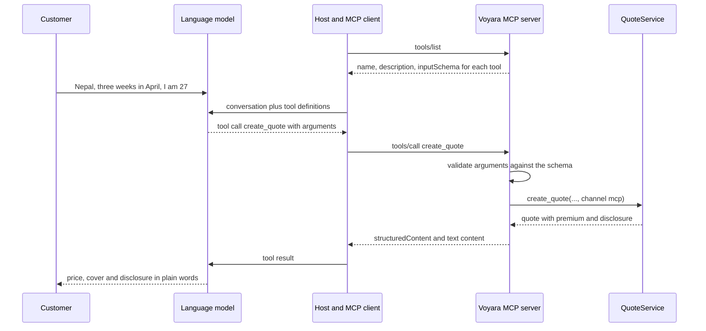

# How MCP works in Voyara

> *(Detail level: 2 - Component Map. The walkthrough section is at level 4 - Full Implementation.)*

This page explains how a headless AI agent, such as a chat assistant, gets a travel insurance quote from Voyara through the Model Context Protocol (MCP). It names the parts involved and how data moves between them. The [walkthrough](#walkthrough-how-a-tools-parameters-reach-the-model-and-come-back) section then zooms in to show the real schema and messages for one tool call.

Voyara is an example system. The insurer, its prices and its policy wording are all fictitious.

For the in-browser channel, see [How WebMCP works](how-to-webmcp-works.md).

## MCP in one paragraph

MCP is an open protocol that lets an AI application discover and call capabilities offered by a server. It has three roles:

- The **host** is the AI application the person talks to, such as Claude Code or a chat assistant.
- The **client** is the part of the host that speaks MCP.
- The **server** is the system that offers the capabilities.

A server offers three kinds of capability:

- **Tools** are actions the agent can call.
- **Resources** are documents the agent can read.
- **Prompts** are reusable conversation starters.

The agent decides when to call a tool. The server decides what the tool is allowed to do.

## Where MCP sits in Voyara

Voyara runs one Python process with two front doors. The `/mcp` door is for agents that have no browser, and the `/api` door is for the quote web pages. Both lead to the same quote service. As a result, a quote made through MCP and a quote made through the website cost the same, to the cent.

| Layer | Component | File | Role |
| --- | --- | --- | --- |
| Agent side | MCP host and client | Outside this repo (for example Claude Code) | Holds the conversation, picks tools, shows results to the customer |
| Transport | Streamable HTTP endpoint at `/mcp` | `server/src/voyara/app.py` | Receives MCP messages over HTTP POST and returns JSON responses |
| Protection | Rate limiter | `server/src/voyara/ratelimit.py` | Allows 60 MCP calls per minute per client IP, then answers HTTP 429 |
| Protection | DNS-rebinding guard | Built into the MCP SDK | Accepts only localhost Host headers by default |
| Protocol | MCP server | `server/src/voyara/mcp_server.py` | Declares the tools, resources and prompt, and turns rule failures into tool errors |
| Business logic | Quote service | `server/src/voyara/quotes.py` | Creates, updates and retrieves quotes, starts checkout, keeps the audit trail |
| Business logic | Rules | `server/src/voyara/rules.py` | Age caps, pack eligibility, tier recommendation |
| Business logic | Pricing | `server/src/voyara/pricing.py` | Works out the premium from region, days, ages, tier, excess and packs |
| Business logic | Catalogue and product views | `server/src/voyara/catalogue.py`, `products.py` | Tier inclusions, packs, PDS and TMD text, disclosure wording |
| Storage | In-memory quote store | Inside the quote service | Holds quotes for 7 days and checkout sessions for 30 minutes. Lost on restart. |

## How a request travels

Every MCP call follows the same path through the components above.

| Step | From | To | What moves |
| --- | --- | --- | --- |
| 1 | MCP client | `/mcp` endpoint | A JSON-RPC message naming a tool and its arguments |
| 2 | Endpoint | Rate limiter | The request, checked against the client's call count for the last minute |
| 3 | Rate limiter | MCP server | Requests within the limit pass. Requests over it get HTTP 429 with `Retry-After`. |
| 4 | MCP server | Quote service, rules or product views | Validated arguments. Enums such as tier, region and pack are checked against the published tool schema. |
| 5 | Quote service | Rules and pricing | Trip details, to check eligibility and price the trip |
| 6 | Quote service | MCP server | A result with the premium, a `disclosure` block and the `catalogue_version` |
| 7 | MCP server | MCP client | The result as structured content. A broken rule comes back as a tool error with the reason. |

The server runs in stateless mode. Each call stands alone, and the protocol keeps no session between calls. A quote ID carries continuity from one step to the next.

## What the server offers

### Tools

| Tool | Reads or writes | Components it reaches |
| --- | --- | --- |
| `list_policy_tiers` | Reads | Product views, pricing (for starting prices) |
| `compare_tiers` | Reads | Product views, catalogue |
| `explain_inclusion` | Reads | Product views, catalogue |
| `check_eligibility` | Reads | Rules |
| `recommend_tier` | Reads | Rules |
| `create_quote` | Writes a quote | Quote service, rules, pricing |
| `update_quote` | Updates a quote | Quote service, rules, pricing |
| `get_quote` | Reads | Quote service |
| `start_checkout` | Writes a checkout session | Quote service |

Read-only tools are marked with MCP read-only annotations, so a host can call them without asking the person first.

### Resources and prompt

| Kind | Name | Source |
| --- | --- | --- |
| Resource | `voyara://pds/{tier}` | Catalogue: Product Disclosure Statement extract for one tier |
| Resource | `voyara://tmd` | Catalogue: Target Market Determination |
| Prompt | `find_my_cover` | Tells the agent which trip details to ask for before quoting |

## Walkthrough: how a tool's parameters reach the model and come back

> *(Detail level: 4 - Full Implementation)*

This section follows one tool, `create_quote`, through every layer. It starts at the Python function, goes up to the language model's prompt, then follows the model's answer back down to the quote service. The JSON below was captured from this server, trimmed with `...` where noted.



| Hop | Layer | What carries the parameters |
| --- | --- | --- |
| 1 | Voyara MCP server | The Python function signature |
| 2 | MCP protocol | The `tools/list` response, with a JSON Schema per tool |
| 3 | Host | The tool definitions placed in the model's prompt |
| 4 | Language model | A tool call whose arguments match the schema |
| 5 | MCP protocol | The `tools/call` request |
| 6 | Voyara MCP server | Validated, typed Python arguments passed to `QuoteService` |
| 7 | All layers, upwards | The result, back to the model and then the customer |

### Hop 1: the Python signature is the source of truth

There is no hand-written schema in this repo. The SDK reads the tool's signature and docstring in `server/src/voyara/mcp_server.py`:

```python
Tier = Literal["essentials", "explorer", "comprehensive", "elite"]      # catalogue.py
Region = Literal["pacific", "asia", "worldwide_excl_americas", "worldwide"]
Pack = Literal["adventure", "snow", "cruise", "gadget"]
Excess = Literal[0, 100, 200, 250, 500]                                  # mcp_server.py
Age = Annotated[int, Field(ge=0, le=120)]

@mcp.tool(annotations=WRITES)
@_rule_errors_as_tool_errors
async def create_quote(
    destination_region: Region,
    start_date: date,
    end_date: date,
    traveller_ages: list[Age],
    tier: Tier,
    ctx: Context,
    excess: Excess | None = None,
    packs: list[Pack] | None = None,
) -> dict[str, Any]:
    """Price a trip and save the quote for 7 days. Excess defaults to the tier's standard excess. Show the disclosure with the price."""
    return service.create_quote(
        destination_region, start_date, end_date, traveller_ages, tier, excess, packs,
        channel="mcp", client_name=_client_name(ctx),
    )
```

Each Python construct becomes a schema rule:

| Python | JSON Schema the model sees |
| --- | --- |
| Function name `create_quote` | Tool `name` |
| Docstring | Tool `description` |
| `Literal[...]` such as `Tier` | `"enum": [...]` |
| `date` | `"type": "string", "format": "date"` |
| `Annotated[int, Field(ge=0, le=120)]` | `"type": "integer", "minimum": 0, "maximum": 120` |
| Parameter with no default | Listed in `required` |
| `X \| None = None` | `"anyOf": [X, {"type": "null"}], "default": null` (optional) |
| `ctx: Context` | Nothing. The SDK injects it at call time and leaves it out of the schema. |
| `annotations=WRITES` | `annotations` hints such as `"readOnlyHint": false` |

### Hop 2: `tools/list` publishes the schema

When the host connects, its MCP client asks the server what tools it has. On the wire, that is an HTTP POST to `/mcp`:

```json
{ "jsonrpc": "2.0", "id": 1, "method": "tools/list" }
```

The response contains one entry per tool. This is the `create_quote` entry, with three properties trimmed:

```json
{
  "name": "create_quote",
  "description": "Price a trip and save the quote for 7 days. Excess defaults to the tier's standard excess. Show the disclosure with the price.",
  "annotations": { "readOnlyHint": false, "destructiveHint": false, "openWorldHint": false },
  "inputSchema": {
    "type": "object",
    "title": "create_quoteArguments",
    "properties": {
      "destination_region": {
        "type": "string", "title": "Destination Region",
        "enum": ["pacific", "asia", "worldwide_excl_americas", "worldwide"]
      },
      "start_date": { "type": "string", "format": "date", "title": "Start Date" },
      "traveller_ages": {
        "type": "array", "title": "Traveller Ages",
        "items": { "type": "integer", "minimum": 0, "maximum": 120 }
      },
      "tier": { "type": "string", "title": "Tier", "enum": ["essentials", "explorer", "comprehensive", "elite"] },
      "packs": {
        "anyOf": [
          { "type": "array", "items": { "type": "string", "enum": ["adventure", "snow", "cruise", "gadget"] } },
          { "type": "null" }
        ],
        "default": null, "title": "Packs"
      }
    },
    "required": ["destination_region", "start_date", "end_date", "traveller_ages", "tier"]
  }
}
```

`end_date` and `excess` are trimmed above; they follow the same pattern. The response also carries an `outputSchema` that describes the result as an object.

The parameters have generated titles, such as "Start Date", but no descriptions. Everything the model knows about a parameter comes from its name, its type and enum values, and the tool description. Adding `Field(description=...)` to a parameter would give the model more guidance. This repo does that on `trip_cost` in `recommend_tier`.

### Hop 3: the host puts the schema in the model's prompt

MCP stops at the host. The host decides how to show tools to its model, and each host does it a little differently. The common pattern is this:

1. The host converts each MCP tool into the model provider's tool format.
2. It sends that list with every model request, next to the conversation.
3. It adds the server's `instructions` text (Voyara's says to show the disclosure with every price and never call a recommendation personal advice) to the system prompt.

With the Claude Messages API, the `create_quote` entry becomes a tool definition like the one below. Claude Code prefixes the name with the server name, so the model sees `mcp__voyara__create_quote`:

```json
{
  "name": "mcp__voyara__create_quote",
  "description": "Price a trip and save the quote for 7 days. Excess defaults to the tier's standard excess. Show the disclosure with the price.",
  "input_schema": { "type": "object", "properties": { "...": "same as inputSchema above" }, "required": ["..."] }
}
```

The model never sees Python code, the quote service or the pricing formula. It sees only the name, the description and the schema.

### Hop 4: the model fills in the parameters

The customer writes: "I'm going to Nepal for three weeks in April to trek to Everest Base Camp. I'm 27."

The model maps the conversation onto the schema:

| Customer said | Parameter | How the model gets there |
| --- | --- | --- |
| Nepal | `destination_region: "asia"` | Picks one of the four enum values. The MCP channel takes a region, not a country. |
| Three weeks in April | `start_date: "2027-04-01"`, `end_date: "2027-04-21"` | Turns relative dates into the `date` format. A good agent confirms exact dates first. |
| I'm 27 | `traveller_ages: [27]` | An array of integers between 0 and 120 |
| Trekking to Everest Base Camp | `tier: "explorer"`, `packs: ["adventure"]` | Taken from the earlier `recommend_tier` result |
| Nothing about excess | `excess` left out | It is optional, so the tier's standard excess applies |

The model's reply contains a tool call instead of text. In the Claude Messages API, that looks like this:

```json
{
  "type": "tool_use",
  "id": "toolu_01...",
  "name": "mcp__voyara__create_quote",
  "input": {
    "destination_region": "asia",
    "start_date": "2027-04-01",
    "end_date": "2027-04-21",
    "traveller_ages": [27],
    "tier": "explorer",
    "packs": ["adventure"]
  }
}
```

### Hop 5: the client sends `tools/call`

The host removes its name prefix and gives the arguments to its MCP client. The client posts them to `/mcp` unchanged:

```json
{
  "jsonrpc": "2.0",
  "id": 2,
  "method": "tools/call",
  "params": {
    "name": "create_quote",
    "arguments": {
      "destination_region": "asia",
      "start_date": "2027-04-01",
      "end_date": "2027-04-21",
      "traveller_ages": [27],
      "tier": "explorer",
      "packs": ["adventure"]
    }
  }
}
```

Before the request reaches the MCP server, `RateLimitMiddleware` in `server/src/voyara/ratelimit.py` counts it against the client's IP address. The 61st call in a minute gets HTTP 429 and never reaches a tool.

### Hop 6: the server validates and converts the arguments

The SDK checks the arguments against the same types that produced the schema in hop 1. It uses the generated pydantic model `create_quoteArguments` to do this. It also converts them:

- `"2027-04-01"` becomes a Python `date`.
- `[27]` becomes a `list[int]` checked against 0 to 120.
- `ctx` is filled in with the request context, which holds the client's name if the client sent one.

A value outside the schema is rejected before any Voyara code runs. This is what comes back if the model sends `"tier": "platinum"`:

```json
{
  "jsonrpc": "2.0", "id": 3,
  "result": {
    "isError": true,
    "content": [{ "type": "text", "text": "Error executing tool create_quote: 1 validation error for create_quoteArguments\ntier\n  Input should be 'essentials', 'explorer', 'comprehensive' or 'elite' [type=literal_error, ...]" }]
  }
}
```

Valid arguments go to `QuoteService.create_quote` in `server/src/voyara/quotes.py`, with `channel="mcp"` added by the tool. The schema cannot express product rules such as "Gadget Pack requires Comprehensive or above", so the quote service checks those and raises `RuleError`. The tool's wrapper turns that into an MCP tool error:

```python
def _rule_errors_as_tool_errors(fn: Callable) -> Callable:
    @wraps(fn)
    async def wrapper(*args, **kwargs):
        try:
            return await fn(*args, **kwargs)
        except RuleError as err:
            detail = "".join(f" ({k}: {v})" for k, v in err.details.items() if k == "highest_eligible_tier")
            raise ToolError(f"{err}{detail}") from err
    return wrapper
```

```json
{ "jsonrpc": "2.0", "id": 4, "result": { "isError": true, "content": [{ "type": "text", "text": "Error executing tool create_quote: Gadget Pack requires Comprehensive or above" }] } }
```

A tool error is an ordinary result, not a protocol failure. The model reads the reason and can correct itself, for example by suggesting Comprehensive.

The checks therefore run in two layers:

| Check | Layer | Example |
| --- | --- | --- |
| Shape, types, enums, ranges | Schema (SDK, before Voyara code) | `tier` must be one of four values, ages 0 to 120 |
| Product rules | `QuoteService` and `rules.py` | Pack needs a higher tier, age 75 or over capped at Comprehensive, start date in the past |

### Hop 7: the result travels back up

The tool returns a `dict`. The SDK sends it two ways in the same result: as `structuredContent` for clients that read JSON, and as a text copy in `content` for clients that only pass text to the model. This is the result, trimmed:

```json
{
  "jsonrpc": "2.0", "id": 2,
  "result": {
    "isError": false,
    "content": [{ "type": "text", "text": "{\n  \"quote_id\": \"Q-39840\", ... }" }],
    "structuredContent": {
      "quote_id": "Q-39840",
      "status": "active",
      "destination_region": "asia",
      "trip_days": 21,
      "tier": "explorer",
      "excess": 200,
      "packs": ["adventure"],
      "premium": {
        "currency": "AUD",
        "travellers": [{ "age": 27, "amount": "263.00" }],
        "packs": [{ "pack": "adventure", "amount": "49.00" }],
        "total": "312.00"
      },
      "expires_at": "2026-11-16T09:00:00+00:00",
      "channel": "mcp",
      "disclosure": {
        "general_advice_warning": "This is general advice only and does not take into account your objectives, ...",
        "pds_url": "https://voyara.com.au/pds/explorer",
        "tmd_url": "https://voyara.com.au/tmd"
      },
      "catalogue_version": "2026-11-06"
    }
  }
}
```

The host gives this to the model as the tool result, for example a `tool_result` block in the Claude Messages API. The model then writes its answer to the customer. It shows $312, says what Explorer with Adventure Pack covers, and includes the disclosure, because both the tool description and the server instructions ask for it. Money amounts travel as strings such as `"312.00"`, so no layer rounds them.

### What each layer adds and removes

| Layer | Adds | Removes or hides |
| --- | --- | --- |
| Python signature | Types, ranges, enums, the description | Nothing yet |
| `tools/list` | The JSON Schema and annotations | `ctx` and every line of implementation |
| Host | The name prefix, the server instructions and the provider's tool format | MCP framing |
| Model | Concrete argument values from the conversation | Everything not in the schema |
| `tools/call` and the SDK | Type conversion, schema validation, the request context | Invalid input, rejected before Voyara code runs |
| `QuoteService` | Product rules, the price, the disclosure, `channel` and the audit entry | Rule-breaking requests, returned as tool errors |

## A worked journey: Priya trekking in Nepal

Priya, 27, asks her assistant what insurance she needs for three weeks trekking to Everest Base Camp. No browser is involved.

| Step | Tool | Component reached | Outcome |
| --- | --- | --- | --- |
| 1 | `check_eligibility` | Rules | All four tiers are open to a 27-year-old travelling in Asia |
| 2 | `recommend_tier` | Rules | Explorer with Adventure Pack, because Essentials excludes trekking |
| 3 | `create_quote` | Quote service, pricing | Quote saved for 7 days at $312, with disclosure |
| 4 | `compare_tiers` | Product views | Shows what Comprehensive adds for $96 more |
| 5 | `start_checkout` | Quote service | A checkout link valid for 30 minutes |
| 6 | None | Checkout web page | Priya opens the link, reviews the policy and presses Pay herself |

## Boundaries the design enforces

| Boundary | How it is enforced |
| --- | --- |
| Agents cannot buy | No tool takes payment. `start_checkout` only returns a link to a page that needs a human click. |
| General advice only | `recommend_tier` matches trip features to product rules and always returns a note saying so |
| Every price carries disclosure | The quote service adds the `disclosure` block to every priced result. The server instructions tell the agent to show it. |
| Rules live in one place | MCP tools hold no pricing or eligibility logic. They pass through to the quote service. |
| Traceability | Each quote records the channel (`mcp`), the client name when the client sends one, and every action taken on it |
| Fair use | The rate limiter caps each client IP. Phase 1 has no credentials. |

## How MCP relates to WebMCP here

| Question | MCP | WebMCP |
| --- | --- | --- |
| Who calls it | An agent anywhere, with no browser | The agent built into the customer's browser |
| Where the tools live | On the Voyara server, always on | In the open quote page, only while it is open |
| Whose session | The agent's own HTTP calls | The customer's own browser tab |
| Path to the quote service | `/mcp`, then the MCP server | Page tools, then `/api` |
| Channel recorded on the quote | `mcp` | `webmcp` |

Read [How WebMCP works](how-to-webmcp-works.md) for the browser side.
